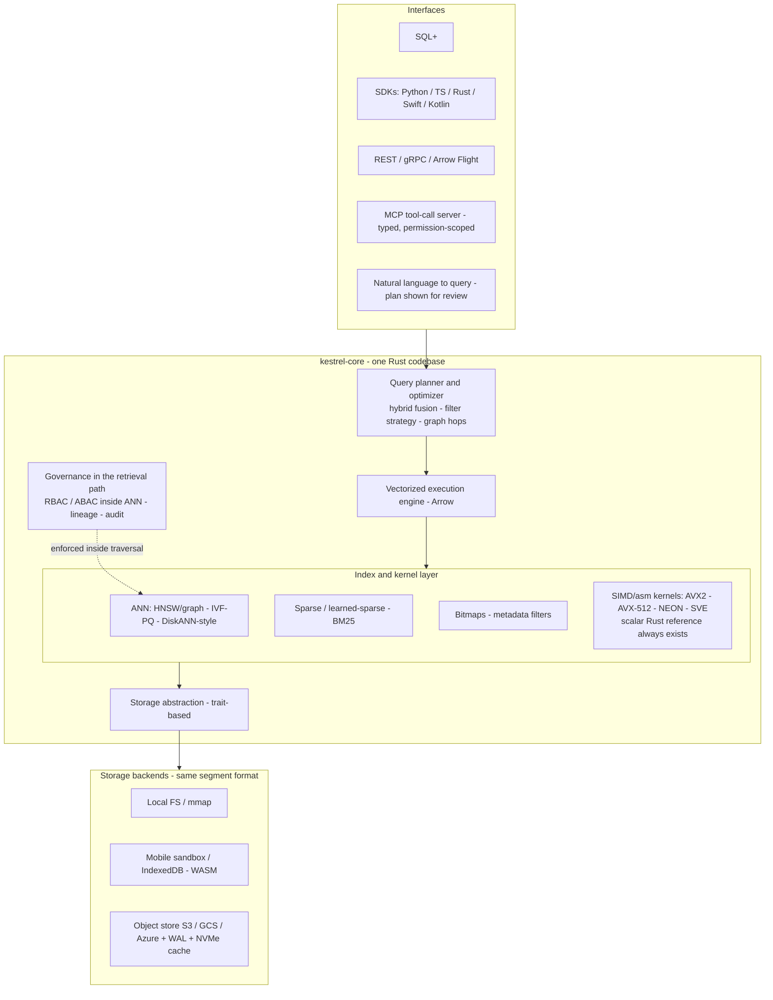
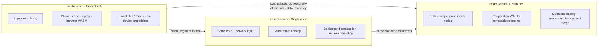
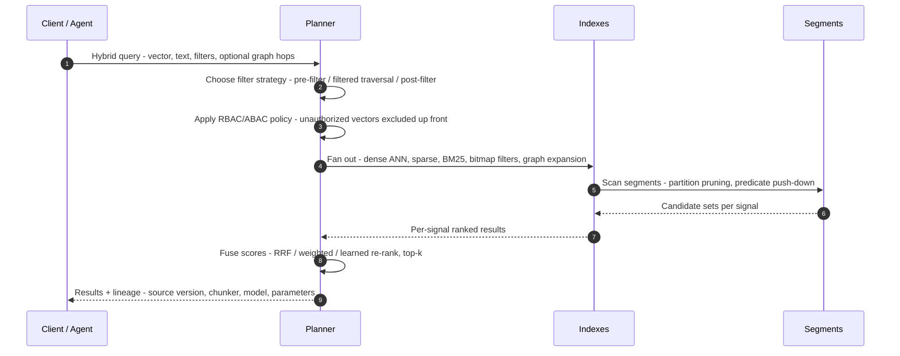
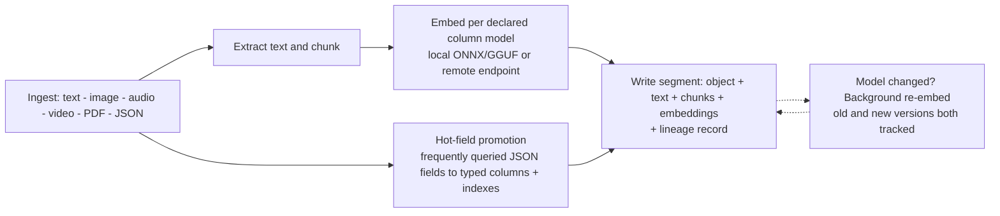
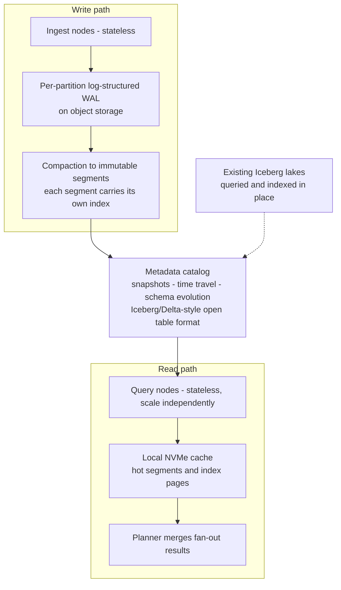
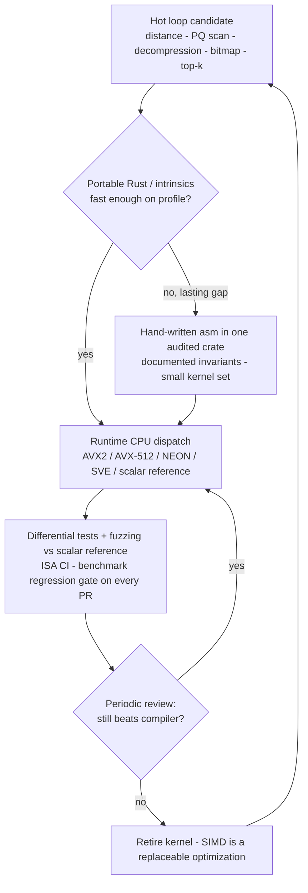
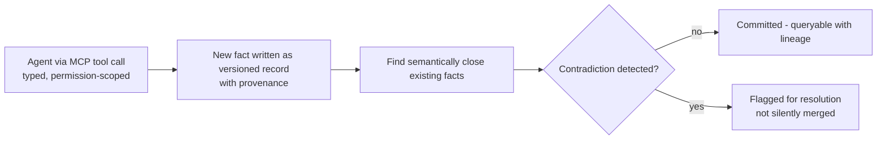
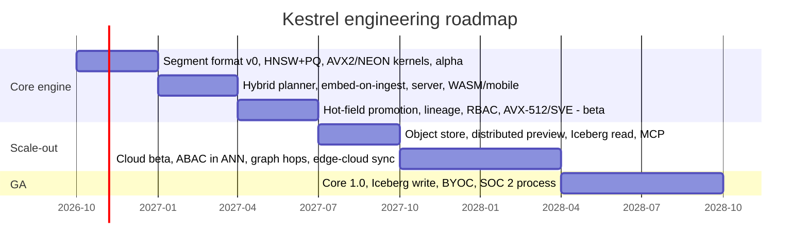

# Kestrel — Architecture & Design

Kestrel is an AI-native, vector-first, multimodal database. One Rust codebase
ships in three forms — an **embedded library** (phone, edge device, laptop,
browser via WASM), a **single-node server**, and a **distributed lakehouse
service** with compute separated from object storage. The data format and
query semantics are the same in all three.

**One-line thesis:** one Rust engine, one segment format, one query planner —
identical semantics embedded on a device, on a single server, and distributed
over object storage. Only the storage backend, scheduler, and coordinator change.

Design trade-offs and launch sequencing live in [launch-plan.md](launch-plan.md).

## 1. System architecture

## 2. Deployment tiers — same core, three forms

## 3. Hybrid query — one primitive, one plan

Dense + sparse + keyword + metadata + graph retrieval is a single primitive,
not five systems stitched together.

## 4. Embed-on-ingest pipeline

## 5. Distributed tier — writes, compaction, reads

## 6. Kernel strategy — SIMD only where it pays

The hottest loops (distance kernels, quantized scans, decompression, bitmap
filtering) are where compilers often under-vectorize. Everything else —
planner, I/O, networking, cache-miss-bound traversal — stays in safe,
idiomatic Rust.

Rules: intrinsics first, hand asm only where profiling shows a lasting gain;
a scalar Rust reference always exists; every kernel is differential-tested
against it; all `unsafe` code is isolated in one audited crate. Benchmarks
decide what ships — see [kernels.md](kernels.md).

## 7. Agent-native write-back and contradiction detection

## 8. Roadmap (engineering sequence)

Near-term work is tracked as GitHub issues. Benchmark methodology:
reproducible harness or it did not happen — losses published alongside wins,
competitors at vendor-recommended settings, recall reported with every
throughput number.

